  

  
  
  
  

<h2 align="center">🛠️ Tech Stack &amp; 3D Skills</h2>

  
   
  

**Languages:** TypeScript · JavaScript · Python · Java · SQL  
**Frontend:** React · Next.js · Tailwind CSS · shadcn/ui · Framer Motion  
**Backend:** Node.js · FastAPI · Django/DRF · Express · REST APIs  
**Data:** PostgreSQL · MongoDB · SQLite · Prisma  
**AI / ML:** PyTorch · TensorFlow · LangChain · LLM fine-tuning · RAG · prompt engineering · computer vision · MCP  
**Tooling:** Docker · Git · GitHub Actions · Linux · Vercel

---

## 🚀 Projects I've Built

| Project | Stack | What it does |
| --- | --- | --- |
| 🧠 [Habify ADHD Dashboard](https://github.com/rumeshprasanga66-boop/ADHDD-DASHBOARD) | `Next.js` `TypeScript` `Prisma` | Budgets, ADHD appointments, daily routines, food and workouts in one calm dashboard. |
| ✨ [Clean Code AI](https://github.com/rumeshprasanga66-boop/clean-code-ai) | `Next.js` `Tailwind` `shadcn/ui` | AI code-quality SaaS landing page with a complete auth flow. |
| 🎯 [AI Prompt Portfolio](https://github.com/rumeshprasanga66-boop/ai-prompt-portfolio) | `HTML` `CSS` `JavaScript` | Static portfolio site about prompt engineering and practical AI prompts. |
| 🤖 [Coding Agent Template](https://github.com/rumeshprasanga66-boop/coding-agent-template) | `AI agents` `Dev tools` | Setup for Claude Code, Codex, Copilot, Cursor, Gemini CLI and opencode. |
| 🧪 [AI Demos](https://github.com/rumeshprasanga66-boop/ai-demos) | `Python` `AI` | Small experiments exploring models, prompts and LLM workflows. |
| 📚 [Awesome Rumesh AI](https://github.com/rumeshprasanga66-boop/awesome-rumesh-ai) | `Curated` `LLM` | A curated index of AI agents, LLM tools and full-stack starters. |

## 🔭 Upstream Projects I Follow &amp; Fork

These are upstream open-source projects I use as references and starting points — I don't claim authorship of the upstream code.

[OpenShorts](https://github.com/rumeshprasanga66-boop/openshorts) · [MCP Image Generator](https://github.com/rumeshprasanga66-boop/MCP-Image-Generator-Uncensored) · [Voice Task Manager](https://github.com/rumeshprasanga66-boop/voice-task-manager) · [Instagram Clone](https://github.com/rumeshprasanga66-boop/Instagram-Clone) · [OpenAI Agents Python](https://github.com/rumeshprasanga66-boop/openai-agents-python) · [Mem0](https://github.com/rumeshprasanga66-boop/mem0) · [Create T3 App](https://github.com/rumeshprasanga66-boop/create-t3-app)

## 📈 GitHub Activity

  
  
  

## 🤝 Open-Source Contribution

[ t3-oss/create-t3-app#2260 ](https://github.com/t3-oss/create-t3-app/pull/2260) — fixed the broken Stripe tutorial link in the FAQ (issue #1993) across EN/PT/RU/UK docs. Currently awaiting code-owner review.

## ✍️ Latest writing

Practical notes on AI agents, RAG, and full-stack building — published on Substack:

- [I Fixed a Broken Link in Create T3 App — Here's What Open Source Actually Rewards](https://rumesh.substack.com/p/i-fixed-a-broken-link-in-create-t3) — a four-file PR, a changeset bot, and what small real contributions actually reward.
- [I Gave My AI Agent a Memory With mem0 — Here’s What Actually Changed](https://rumesh.substack.com/p/i-gave-my-ai-agent-a-memory-with) — what persistent memory changed in a real agent workflow.
- [A Minimal RAG Setup That Actually Works (No Vector Database)](https://rumesh.substack.com/p/a-minimal-rag-setup-that-actually) — a simple retrieval setup you can run locally.
- [The AI Product Stack I Actually Use as a Solo Developer in 2026](https://rumesh.substack.com/p/the-ai-product-stack-i-actually-use) — boring tools that keep shipping simple.

[Subscribe on Substack](https://rumesh.substack.com/subscribe) if you want these notes in your inbox.

## 📫 Get in Touch

Have a project, idea, or question? I'd love to hear about it.

- Email: [rumeshprasanga66@gmail.com](mailto:rumeshprasanga66@gmail.com)
- GitHub: [@rumeshprasanga66-boop](https://github.com/rumeshprasanga66-boop)
- Portfolio: [rumeshprasanga66-boop.github.io/portfolio](https://rumeshprasanga66-boop.github.io/portfolio/)

> 💡 The animations above are hand-built SVG files in [`assets/`](https://github.com/rumeshprasanga66-boop/rumeshprasanga66-boop/tree/main/assets). GitHub strips CSS from READMEs, so motion is delivered as animated SVG images instead. A reusable template is available in [`README-TEMPLATE.md`](https://github.com/rumeshprasanga66-boop/rumeshprasanga66-boop/blob/main/README-TEMPLATE.md).
